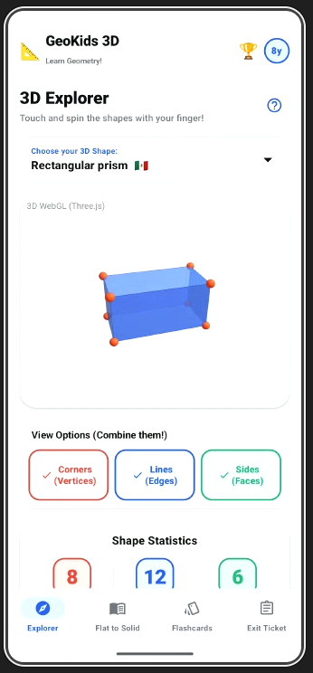
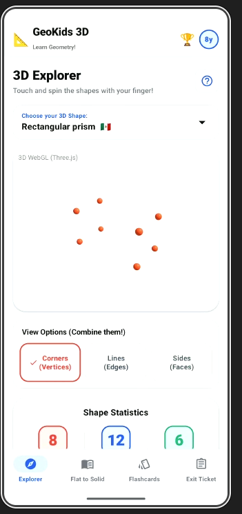
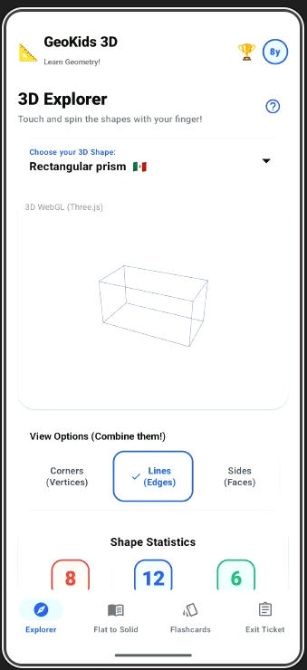
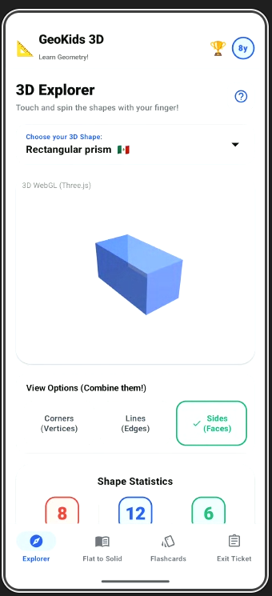

# GeoKids 3D 📐

An Android app that helps kids ages 8–9 learn 3D geometry by touching and spinning shapes with their finger.

I built it for my daughter. She was learning solids at school, and flat drawings in a notebook weren't clicking. Being able to rotate a prism and count its corners herself made the difference.

## What kids do

- **3D Explorer:** spin shapes like prisms, cubes and pyramids, and turn on vertices, edges and faces to see and count them
- **Flat to Solid:** connect 2D figures with the 3D shapes they form
- **Flashcards:** quick review of names and properties
- **Exit Ticket:** a short check at the end, like the ones teachers use in class
- Bilingual (English / Spanish) and progress rewards

## Built with

- Kotlin (native Android) with a WebGL view (Three.js) for the 3D shapes
- Google AI Studio and the Gemini API

## Screenshots

| Full shape | Vertices | Edges | Faces |
|---|---|---|---|
|  |  |  |  |

## What I learned

Kids don't read instructions, they tap everything. Every screen had to explain itself through visuals, and every action needed a clear, immediate response.

## Run locally

**Prerequisites:** [Android Studio](https://developer.android.com/studio)

1. Open Android Studio and select **Open**, then choose this project's folder
2. Let Android Studio fix any incompatibilities during import
3. Create a `.env` file in the project folder and set `GEMINI_API_KEY` to your Gemini API key (see `.env.example`)
4. Remove this line from `build.gradle.kts`: `signingConfig = signingConfigs.getByName("debugConfig")`
5. Run the app on an emulator or a physical device

---

Made by [Arturo Mendoza](https://iamuxui.dev), UX/UI designer.
